<!-- Animated Hero Banner -->

 

<!-- Connect Quick Badges -->

  
  &nbsp;
  
  &nbsp;
  
  &nbsp;
  

<!-- Animated Section Separator -->

## ⚡ Core Engineering Pillars

  

---

## 🏆 Flagship Case Study — Mentrix

  

> **Mentrix** is a production-grade mentor–mentee governance ecosystem engineered with Django for institutional scale. It centralizes academic guidance, departmental reporting, and mentoring telemetry across multiple administrative roles.

```mermaid
graph LR
    subgraph MultiTenantAuth ["Enterprise Security & Gatekeeping"]
        A1["Domain-Restricted Google OAuth2"]
        A2["Single-Session Concurrency Control"]
        A3["Multi-Tenant RBAC Middleware"]
    end

    subgraph UserPortals ["Role-Specific Workflows"]
        P1["Student Portal (Booking & Feedback)"]
        P2["Faculty Portal (Availability & Notes)"]
        P3["HOD Oversight (Audit & Analytics)"]
        P4["Super Admin (Role Switching)"]
    end

    subgraph DeepServices ["Edge AI & Intelligence Engine"]
        S1["Local Ollama LLM Inference"]
        S2["ReportLab PDF Dossier Generator"]
        S3["Automated SMTP Reminders"]
    end

    MultiTenantAuth --> UserPortals
    UserPortals --> DeepServices
```

### Key Architectural Highlights
- **Role-Based Multi-Tenancy:** Unified authorization matrix supporting instant role-switching between `Student`, `Faculty`, `Faculty_Admin`, `HOD`, and `Super_Admin` without data leakage.
- **Edge AI Integration:** Integrated local LLM inference via Ollama for privacy-first, on-premise mentoring sentiment and summary analytics.
- **Defense-in-Depth Security:** Custom middleware enforcing zero-cache security headers, active session invalidation upon concurrent logins, and domain email validation.
- **Automated Dossier Generation:** End-to-end report generation compiling student progression metrics into institutional-grade PDFs using ReportLab.

---

## 🚀 Featured Engineering Portfolio

  

 

### 1. [Mentrix](https://github.com/KishoreM-04) `Flagship Platform`
- **Focus:** Multi-tenant institutional mentor–mentee governance and analytics platform.
- **Key Features:** Granular RBAC, Google OAuth2 domain lock, single-session guard, local Ollama LLM integration, and dynamic PDF telemetry reporting.
- **Tech Stack:** `Python` · `Django` · `Ollama (Local LLM)` · `Google OAuth` · `ReportLab` · `MySQL/SQLite`

### 2. [Integrated Food & Grocery Delivery Ecosystem](https://github.com/KishoreM-04/Integrated-Food-Grocery-Delivery-App) `Full-Stack Mobile + Web`
- **Web Portal:** [Integrated-Food-Grocery-Delivery-Web](https://github.com/KishoreM-04/Integrated-Food-Grocery-Delivery-Web) — Django administrative dashboard and merchant order management.
- **Android App:** [Integrated-Food-Grocery-Delivery-App](https://github.com/KishoreM-04/Integrated-Food-Grocery-Delivery-App) — Native Android Java mobile client with Picasso image caching, live menu feeds, cart calculation, and REST API integration.
- **Tech Stack:** `Android (Java)` · `Django` · `Python` · `MySQL` · `Picasso` · `REST API`

### 3. [Remote-Control-for-Air-Purifying-Robot (EcoBreath / PuriBot)](https://github.com/KishoreM-04/Remote-Control-for-Air-Purifying-Robot) `IoT & Hardware Telemetry`
- **Focus:** Native Android controller and telemetry dashboard for an autonomous air-purifying robot.
- **Key Features:** Bidirectional hardware communication, live air-quality sensor telemetry, directional drive controls, and pre-built distribution APK (`EcoBreath .apk`).
- **Tech Stack:** `Android (Java)` · `IoT Telemetry` · `MQTT / Hardware Signals` · `Embedded UI`

### 4. [TaskFlow — Cloud Full-Stack Task Engine](https://github.com/KishoreM-04/TaskFlow) `Cloud PaaS & Django 5.x`
- **Focus:** Modern production task management web app with priority matrices and live AJAX reactivity.
- **Key Features:** Dynamic metrics dashboard, asynchronous task status toggling without page reload, overdue highlighting, and Railway PaaS deployment.
- **Tech Stack:** `Django 5.1` · `Python 3.11` · `Railway PaaS` · `WhiteNoise` · `Gunicorn` · `AJAX`

### 5. [Medical Equipment Warehouse Management System](https://github.com/KishoreM-04/Medical-Equipment-Warehouse-Management-System) `Enterprise Logistics`
- **Focus:** Comprehensive inventory and dispatch tracking system designed for medical equipment depots.
- **Key Features:** Multi-branch inventory tracking, requisition approvals, stock level thresholds, and database-backed branch transfer workflows.
- **Tech Stack:** `PHP` · `MySQL` · `Relational DB Schema` · `Branch Logistics`

### 6. [Splendore 2025 Photo Booth](https://github.com/KishoreM-04/Splendore_2025-Photo-Booth) `Android Event Tech`
- **Focus:** Native Android camera application built for the Splendore Intercollegiate Festival.
- **Key Features:** Real-time circular frame camera preview, custom festive branded SVG/PNG overlays, high-resolution snapshot rendering, and release APK (`Splendore.apk`).
- **Tech Stack:** `Android (Java)` · `Camera API` · `Custom Frame Pipeline` · `Release APK`

### 7. [Dignito Fest Management App](https://github.com/KishoreM-04/Dignito-Fest-Management-App) `Cross-Platform Mobile`
- **Focus:** Mobile fest operations client for Dignito College Fest event registration and schedule tracking.
- **Key Features:** Multi-event schedule catalog, registration processing, announcements, and fluid cross-platform animations.
- **Tech Stack:** `Flutter` · `Dart` · `Material 3` · `Mobile State Engine`

### 8. [GPT Helper App & Library](https://github.com/KishoreM-04/GPT_Helper_App) `Applied AI & Tooling`
- **Focus:** Lightweight Python library and Flask web interface for interactive conversational AI workflows.
- **Key Features:** Clean API abstraction wrapper, multi-session conversation history, auto-generated session titles, and keyboard navigation (`Shift+Enter` multi-line).
- **Tech Stack:** `Python` · `Flask` · `OpenAI API` · `Session Memory` · `Bootstrap 5`

---

## 📈 Public Contribution Activity

  <picture>
    <source media="(prefers-color-scheme: dark)" srcset="assets/github-contribution-snake-dark.svg">
    <source media="(prefers-color-scheme: light)" srcset="assets/github-contribution-snake.svg">
    
  </picture>

 

  
  &nbsp;
  

---

<!-- Animated Section Separator -->

### 🤝 Let's Connect & Collaborate

Whether you're exploring enterprise Django engineering, Android & IoT telemetry, or full-stack software development:

**[LinkedIn](https://www.linkedin.com/in/kishorem2004)** • **[Email](mailto:kishor.mullappilly@gmail.com)** • **[GitHub Repositories](https://github.com/KishoreM-04?tab=repositories)** • **[Portfolio](https://kishorem-04.github.io)**

© 2026 Kishore M · Engineered with passion in Kerala, India 🇮🇳

