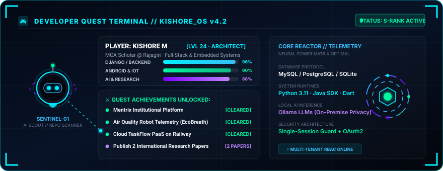
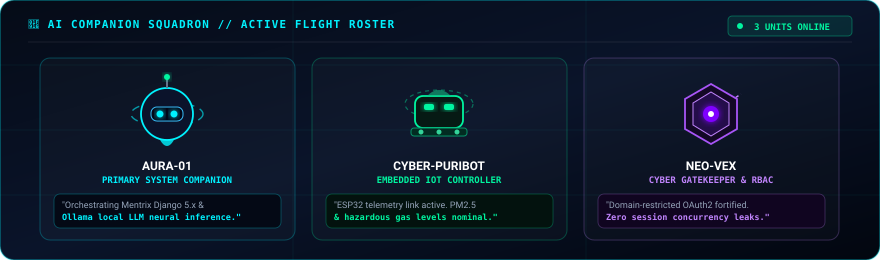
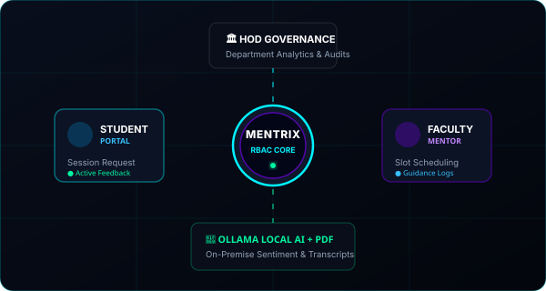
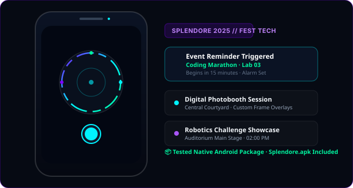
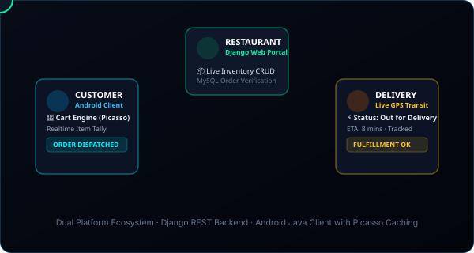
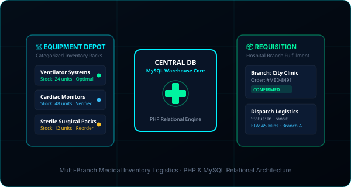

<!-- Futuristic AI Hero Banner -->

 

<!-- Holographic Control Quicklinks -->

  
  &nbsp;
  
  &nbsp;
  
  &nbsp;
  

<!-- Laser Separator Beam -->

<!-- Gamified Developer Quest Terminal & AI Scout Sentinel -->

  

 

<!-- AI Companion Squadron Flight Roster -->

  

---

## ⚡ Technical Arsenal & System Competencies

  

 

| Operational Sector | Verified Technologies | Production Implementation Depth |
| :--- | :--- | :--- |
| **Backend &amp; Core Systems** | `Python`, `Django 5.x`, `Flask`, `PHP`, `C++`, `Java`, `C` | Multi-tenant RBAC, single-session concurrency protection, RESTful API design, Gunicorn WSGI. |
| **Relational Databases** | `MySQL`, `PostgreSQL`, `Oracle`, `SQLite` | 3NF schema normalization, ACID transaction integrity, automated backup routines, query indexing. |
| **Mobile &amp; Client Systems** | `Android (Java)`, `Flutter / Dart` | Real-time circular camera viewfinder overlays, Picasso caching, responsive asynchronous UI flows. |
| **IoT &amp; Robotics Telemetry** | `ESP32`, `Sensors (PM2.5/Gas)`, `MQTT`, `Wireless` | Continuous air quality telemetry acquisition, motor driver logic, mobile remote vehicle steering. |
| **Edge AI &amp; Tooling** | `Local Ollama LLMs`, `OpenAI API`, `ReportLab PDF`, `Railway` | On-premise mentoring sentiment analysis, automated report generation, PaaS cloud pipelines. |

---

## 🚀 Featured Project Missions & System Architectures

### ⚡ MISSION 01: Mentrix — Enterprise Institutional Mentoring Platform

  
  
  
  

  

> 🤖 **AURA-01 Tactical Telemetry:**  
> *"Mentrix is an institutional flagship platform currently deployed under the college server domain. Designed to eliminate administrative bottlenecks, it orchestrates four discrete stakeholder workflows (Student, Faculty Mentor, Head of Department, Super Admin) with zero cloud data leakage by executing on-premise Ollama neural inference."*

| Architectural Pillar | Technical Specification & Implementation |
| :--- | :--- |
| **Role-Based Governance** | Discrete portal access for Students, Mentors, HODs, and Super Admins with role-switching logic. |
| **Session Lifecycle Engine** | Real-time slot reservation, automated mentor confirmation, and historical guidance audit tracking. |
| **Enterprise Security Guard** | Domain-restricted Google OAuth2, single-session concurrency enforcement, and OTP password recovery. |
| **Edge AI & Document Engine** | Local Ollama LLM integration for meeting summaries and dynamic ReportLab PDF dossier generation. |

🔗 **Source Telemetry:** [Inspect Mentrix Repository & Case Study ➔](https://github.com/KishoreM-04)

---

### 📱 MISSION 02: Splendore 2025 — Mobile Reminder & Photobooth Application

  
  
  

  

> 🤖 **SENTINEL-01 Tactical Telemetry:**  
> *"Developed for the flagship intercollegiate fest Splendore 2025. Engineered a custom camera engine featuring a real-time circular viewfinder and branded festival overlays, alongside a multi-track notification reminder scheduler for event attendees."*

| Feature Module | Engineering Details |
| :--- | :--- |
| **Custom Circular Camera** | Hardware camera feed transformed into a circular portrait viewfinder with festival graphic overlays. |
| **Notification Scheduler** | Background reminder system alerting participants prior to competition start times across multiple tracks. |
| **Client Reliability** | Zero-latency local caching, packaged with a production-ready compiled APK (`Splendore.apk`). |

🔗 **Source Telemetry:** [Inspect Splendore Photo Booth Repository ➔](https://github.com/KishoreM-04/Splendore_2025-Photo-Booth)

---

### 📡 MISSION 03: IoT Air Quality Robot & Wireless Controller (EcoBreath / PuriBot)

  
  
  

  

> 🤖 **CYBER-PURIBOT Tactical Telemetry:**  
> *"An embedded robotics platform uniting environmental telemetry with physical mobility. An ESP32 microcontroller continuously reads ambient air particulate (PM2.5) and hazardous gases, streaming data to a custom native Android controller that provides directional motor steering."*

| Hardware & Software Stack | Operational Architecture |
| :--- | :--- |
| **Microcontroller Engine** | ESP32 board handling wireless data packets, sensor reading loops, and H-bridge motor commands. |
| **Mobile Steering Console** | Java Android application providing directional touch controls and real-time sensor gauge readouts. |
| **Environmental Telemetry** | High-precision analog/digital gas and particulate detection calibrated for industrial/indoor hazards. |

🔗 **Source Telemetry:** [Inspect Remote Control Air Purifying Robot Repository ➔](https://github.com/KishoreM-04/Remote-Control-for-Air-Purifying-Robot)

---

### 🛵 MISSION 04: Food & Grocery Delivery Ecosystem

  
  
  

  

> 🤖 **AURA-01 Tactical Telemetry:**  
> *"A synchronized two-tier commerce platform linking web administration with native mobile ordering. Features Picasso-accelerated catalog rendering, atomic checkout workflows, and multi-actor database state synchronization."*

| System Layer | Implementation Highlights |
| :--- | :--- |
| **Customer Android Client** | Fluid catalog navigation, Picasso asynchronous image caching, and localized cart management. |
| **Django Backend Console** | Administrative order fulfillment dashboard, restaurant catalog CRUD, and inventory management. |
| **Database Schema** | Normalized MySQL relational database managing customer credentials, order histories, and merchant records. |

🔗 **Source Telemetry:** [Android Delivery Client Repository](https://github.com/KishoreM-04/Integrated-Food-Grocery-Delivery-App) • [Django Delivery Web Backend Repository](https://github.com/KishoreM-04/Integrated-Food-Grocery-Delivery-Web)

---

### 🏥 MISSION 05: Medical Equipment Warehouse Management System

  
  
  

  

> 🤖 **NEO-VEX Tactical Telemetry:**  
> *"Critical hospital supply-chain portal handling medical equipment procurement, maintenance tracking, and inter-departmental inventory distribution across institutional branches."*

| Core Capability | Functional Workflow |
| :--- | :--- |
| **Stock Tracking Engine** | Real-time monitoring of available medical equipment quantities, model identifiers, and maintenance states. |
| **Requisition & Dispatch** | Hospital department cart requisition system with administrative approval and dispatch logging. |
| **Relational Database** | Relational MySQL schema engineered for inventory transactions, audit integrity, and reporting. |

🔗 **Source Telemetry:** [Inspect Medical Equipment Warehouse Repository ➔](https://github.com/KishoreM-04/Medical-Equipment-Warehouse-Management-System)

---

### 🌐 Additional Featured Tactical Nodes

<table width="100%">
  <tr>
    <td width="33%" valign="top">
      <h4><a href="https://github.com/KishoreM-04/TaskFlow">☁️ TaskFlow PaaS</a></h4>
      
Cloud task governance platform built with <strong>Django 5.1</strong>, dynamic AJAX task state updates, Gunicorn, WhiteNoise, and automated deployment on <strong>Railway PaaS</strong>.

      <code>Django 5.1 · Railway · AJAX</code>
    </td>
    <td width="33%" valign="top">
      <h4><a href="https://github.com/KishoreM-04/Dignito-Fest-Management-App">🎪 Dignito Fest App</a></h4>
      
Cross-platform mobile application developed in <strong>Flutter</strong> for college fest management, real-time schedule broadcasting, and attendee event registration.

      <code>Flutter · Dart · Material 3</code>
    </td>
    <td width="33%" valign="top">
      <h4><a href="https://github.com/KishoreM-04/GPT_Helper_App">🧠 GPT Helper App</a></h4>
      
Lightweight Python package and Flask web interface providing persistent chat sessions, markdown formatting, and OpenAI LLM conversational memory.

      <code>Python · Flask · OpenAI API</code>
    </td>
  </tr>
</table>

---

## 📊 Developer Activity Matrix

  

> 🛰️ *The Developer Activity Matrix visualizes real development telemetry across all 11 public repositories, tracking architectural commits, hardware firmware updates, and academic research milestones. Native GitHub contribution calendar data is verified and preserved.*

---

## 🎓 Academic Background & Research Publications

### 📚 Academic Trajectory
- **Master of Computer Applications (MCA)**  
  **Rajagiri College of Social Sciences (Autonomous)**, Kalamassery, Kochi, Kerala  
  *Expected Graduation: 2027*
- **Bachelor of Computer Applications (BCA)**  
  **De Paul Institute of Science and Technology**, Angamaly, Kerala  
  *Graduated: May 2025* — **CGPA: 8.78**
- **Higher Secondary Education:** Union Higher Secondary School, Mambra, Thrissur (1077/1200)

### 🔬 Peer-Reviewed Research Publications
1. **“Revolutionizing Healthcare: The Integration of Robotics in Medicine”**  
   *Presented a review paper at **DeNovo23**, an International Conference at DePaul Institute of Science and Technology, Angamaly.*
2. **“Examining the Impact of Artificial Intelligence on Personalized Healthcare (From Predictive Diagnostics to Customized Treatment Plans)”**  
   *Presented and published research paper at the International AI and ML Conference organized by Bharata Mata College, Thrikkakara.*  
   **ISBN: 978-81-973274-9-0**

---

<!-- Laser Separator Beam -->

### 🌌 Enter the Interactive 3D Portfolio Lab

Experience the live interactive Web Lab featuring real-time particle physics, playable Cyber Arcade quest, and the responsive AURA-01 companion:

**👉 [Launch Kishore M's Interactive AI Portfolio](https://kishorem-04.github.io)**

 

**[LinkedIn Profile](https://www.linkedin.com/in/kishorem)** • **[Direct Email](mailto:kishor.mullappilly@gmail.com)** • **[GitHub Repositories](https://github.com/KishoreM-04?tab=repositories)**

© 2026 Kishore M · Engineered with passion in Kerala, India 🇮🇳

