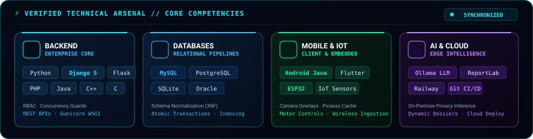

<!-- Futuristic AI Hero Banner with AURA-01 Companion -->

 

<!-- Holographic Control Quicklinks -->

  
  &nbsp;
  
  &nbsp;
  
  &nbsp;
  

<!-- Laser Separator Beam -->

## 🤖 Meet AURA-01 — My Digital AI Companion

<table border="0" width="100%">
  <tr>
    <td width="35%" align="center">
      
    </td>
    <td width="65%" valign="middle">
      <h3><code>SYSTEM STATUS: AURA-01 ONLINE // NEURAL TELEMETRY ACTIVE</code></h3>
      

        <strong>AURA-01</strong> is the signature digital intelligence of this profile — an autonomous robotic companion engineered to monitor repository health, telemetry signals, and system deployments.
      

      <ul>
        <li><strong>Primary Mission:</strong> Full-Stack Platform Architecture, IoT Robotics &amp; Intelligent AI Integration.</li>
        <li><strong>Active Telemetry:</strong> 11 public repositories synchronized, 8 featured architectures, 2 published research papers.</li>
        <li><strong>Interactive Directive:</strong> <em>"Welcome to Kishore's universe. Scroll below to explore production ecosystems or navigate to the live interactive Web Lab."</em></li>
      </ul>
    </td>
  </tr>
</table>

---

## ⚡ Interactive AI Control Center & Verified Tech Stack

  

| Sector | Core Verified Technologies | Implementation Depth |
| :--- | :--- | :--- |
| **Backend &amp; Systems** | `Python`, `Django 5.x`, `Flask`, `PHP`, `C++`, `Java`, `C` | Multi-tenant RBAC, Single-Session concurrency guards, REST APIs, Gunicorn. |
| **Relational Databases** | `MySQL`, `PostgreSQL`, `Oracle`, `SQLite` | Complex schema normalization, optimized CRUD pipelines, transaction isolation. |
| **Mobile Client Systems** | `Android (Java)`, `Flutter / Dart` | Custom circular camera overlays, Picasso image caching, responsive Material UI. |
| **IoT &amp; Robotics** | `ESP32`, `Sensors (PM2.5/Gas)`, `MQTT`, `Wireless Telemetry` | Real-time air quality telemetry ingestion, remote omnidirectional robotic drive. |
| **Applied AI &amp; Tooling** | `Local Ollama LLMs`, `OpenAI API`, `ReportLab PDF`, `Railway`, `Git` | On-premise mentoring sentiment analysis, dynamic PDF dossiers, cloud CI/CD. |

---

## 🏆 Project 1: Mentrix — Flagship Institutional Mentoring Ecosystem

  

> **Mentrix** is a production-grade institutional mentor–mentee governance and academic telemetry platform. Developed using **Django** and **MySQL**, it is officially deployed under the college server domain and integrated into daily institutional operations.

```mermaid
graph LR
    subgraph MultiTenantAuth ["Enterprise Security & Gatekeeping"]
        A1["Domain-Restricted Google OAuth2"]
        A2["Single-Session Concurrency Guard"]
        A3["Role-Based Access Control (RBAC)"]
    end

    subgraph UserPortals ["Role-Specific Workflows"]
        P1["Student Portal (Bookings & Progress)"]
        P2["Faculty Portal (Slots & Guidance Logs)"]
        P3["HOD Oversight (Audit & Analytics)"]
        P4["Super Admin (Role Switching Engine)"]
    end

    subgraph DeepServices ["Edge AI & Intelligence Engine"]
        S1["Local Ollama LLM Inference"]
        S2["ReportLab PDF Dossier Generator"]
        S3["Automated SMTP Reminders"]
    end

    MultiTenantAuth --> UserPortals
    UserPortals --> DeepServices
```

### Key Engineering Achievements
- **Role-Based Governance:** Discrete dashboards for students, faculty mentors, department heads, and super administrators with secure authentication.
- **Session Lifecycle Engine:** Modules for mentoring session requests, approvals, and meeting history tracking for structured monitoring of student progress.
- **Enterprise Security:** OTP-based password recovery, automated email notifications, file upload sanitization, and active single-session guards.
- **Local AI Telemetry:** On-premise Ollama LLM integration for privacy-safe conversation sentiment analysis without cloud data leakage.

---

## 📱 Project 2: Splendore 2025 — Mobile Reminder & Photobooth Application

  

- **Focus:** Native Android mobile application created for the intercollegiate fest *Splendore 2025*.
- **Key Features:**
  - **Dynamic Mobile Reminder System:** Enabled attendees to view multi-track event schedules, configure notifications, and receive timely alerts.
  - **Custom Circular Photo-Booth Engine:** Real-time circular camera viewfinder with custom festive branded overlays for instant portrait generation.
- **Tech Stack:** `Android`, `Java`, `Camera API / Overlays`, `Pre-compiled Splendore.apk Included`.
- **Repository:** [KishoreM-04/Splendore_2025-Photo-Booth](https://github.com/KishoreM-04/Splendore_2025-Photo-Booth)

---

## 📡 Project 3: IoT Air Quality Detection & Mobile-Controlled Robotic System

  

- **Focus:** Team-based embedded systems project combining real-time environmental monitoring with robotic mobility.
- **Key Features:**
  - **Environmental Telemetry:** Connected air-quality sensors to an **ESP32 microcontroller** for continuous particulate (PM2.5) and gas telemetry acquisition.
  - **Android Remote Controller:** Native Android app (**EcoBreath / PuriBot**) built in Java to wirelessly steer the robotic platform and display live sensor telemetry.
  - **System Integration:** End-to-end integration of wireless communication protocols, motor driver logic, and mobile UI controls.
- **Tech Stack:** `Android (Java)`, `ESP32 Microcontroller`, `Environmental Sensors`, `Wireless IoT Telemetry`, `Release APK`.
- **Repository:** [KishoreM-04/Remote-Control-for-Air-Purifying-Robot](https://github.com/KishoreM-04/Remote-Control-for-Air-Purifying-Robot)

---

## 🛵 Project 4: Online Food & Grocery Delivery Application

  

- **Focus:** Dual-tier e-commerce ecosystem comprising a Django web backend and native Android customer mobile client.
- **Key Features:**
  - Multi-stakeholder dashboards for customer orders, restaurant catalog management, and delivery partner routing.
  - Picasso-powered image caching for high-speed menu browsing without UI stutter.
  - MySQL database handling customer auth, cart calculations, order status transitions, and store inventory control.
- **Tech Stack:** `Django (Python)`, `Android (Java)`, `MySQL`, `Picasso`, `REST API`.
- **Repositories:** [Delivery Android App](https://github.com/KishoreM-04/Integrated-Food-Grocery-Delivery-App) • [Delivery Django Backend](https://github.com/KishoreM-04/Integrated-Food-Grocery-Delivery-Web)

---

## 🏥 Project 5: Medical Equipment Warehouse Management System

  

- **Focus:** Supply-chain logistics and equipment dispatch management web platform.
- **Key Features:**
  - Multi-branch hospital inventory requisition, stock tracking, and approval flows.
  - Optimized MySQL relational database schema for equipment tracking, categories, and maintenance statuses.
  - Responsive administrative interface with dynamic cart requisition and order confirmation logic.
- **Tech Stack:** `PHP`, `MySQL`, `Bootstrap 4`, `JavaScript`, `Relational Schema`.
- **Repository:** [KishoreM-04/Medical-Equipment-Warehouse-Management-System](https://github.com/KishoreM-04/Medical-Equipment-Warehouse-Management-System)

---

## 🌐 More Featured Architectures

- **[TaskFlow](https://github.com/KishoreM-04/TaskFlow):** Cloud-configured task management platform with Django 5.1, AJAX reactivity, Gunicorn, WhiteNoise, and Railway PaaS deployment.
- **[Dignito Fest Management App](https://github.com/KishoreM-04/Dignito-Fest-Management-App):** Cross-platform Flutter mobile client for college fest schedules, event registration, and attendee coordination.
- **[GPT Helper App & Package](https://github.com/KishoreM-04/GPT_Helper_App):** Lightweight Python library and Flask ChatGPT-style interface with concurrent chat sessions and persistent sidebar memory.

---

## 📊 Developer Activity Matrix

  

> *The Developer Activity Matrix represents synchronized development telemetry across all 11 public repositories, tracking code commits, system architectures, and academic research milestones. Native GitHub contribution calendar data is verified and preserved.*

---

## 🎓 Education & Research Publications

### 📚 Academic Background
- **Master of Computer Applications (MCA)**  
  **Rajagiri College of Social Sciences (RCSS) (Autonomous)**, Kalamassery, Ernakulam, Kerala  
  *Expected Graduation: 2027*
- **Bachelor of Computer Applications (BCA)**  
  **De Paul Institute of Science and Technology**, Angamaly, Ernakulam, Kerala  
  *Graduated: May 2025* — **CGPA: 8.78**
- **Higher Secondary Education:** Union Higher Secondary School, Mambra, Thrissur (1077/1200)

### 🔬 Research & Conference Publications
1. **“Revolutionizing Healthcare: The Integration of Robotics in Medicine”**  
   *Presented a review paper at **DeNovo23**, an International Conference at DePaul Institute of Science and Technology, Angamaly.*
2. **“Examining the Impact of Artificial Intelligence on Personalized Healthcare (From Predictive Diagnostics to Customized Treatment Plans)”**  
   *Presented and published research paper at the International AI and ML Conference hosted by the Department of Computer Science, Bharata Mata College, Thrikkakara.*  
   **ISBN: 978-81-973274-9-0**

---

<!-- Laser Separator Beam -->

### 🌌 Enter the Interactive AI Portfolio Universe

Explore the 3D-inspired digital laboratory with live particle constellations, interactive AI companion reactions, and dynamic control centers:

**👉 [Launch Kishore M's Interactive Portfolio](https://kishorem-04.github.io)**

 

**[LinkedIn](https://www.linkedin.com/in/kishorem)** • **[Email](mailto:kishor.mullappilly@gmail.com)** • **[GitHub Repositories](https://github.com/KishoreM-04?tab=repositories)**

© 2026 Kishore M · Engineered with passion in Kerala, India 🇮🇳

