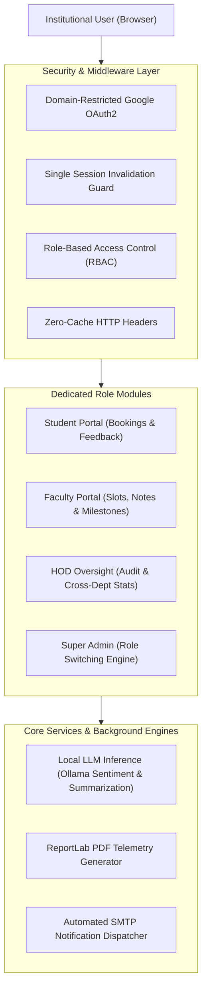

# Mentrix — Institutional Mentor–Mentee Management Platform

[](https://python.org)
[](https://djangoproject.com)
[](https://ollama.ai)
[](https://github.com/KishoreM-04)
[](LICENSE)

> A production-grade mentor–mentee governance and analytics platform built with Django for educational institutions. Mentrix unifies students, faculty mentors, department heads, and system administrators into a role-governed ecosystem with local AI telemetry and automated PDF dossier compilation.

---

## 🏗️ System Architecture



---

## ✨ Key Capabilities

### 1. Granular Role-Based Access Control (RBAC)
- Five discrete role namespaces: `Student`, `Faculty`, `Faculty_Admin`, `HOD`, and `Super_Admin`.
- Native role-switching module for authorized users holding hybrid institutional responsibilities (e.g., a Faculty member who also acts as Faculty Admin or HOD).

### 2. Multi-Layer Defense-in-Depth Security
- **Domain-Restricted OAuth2:** Authentication pipeline locked strictly to verified institutional email domains, blocking unauthorized third-party sign-ins.
- **Single-Session Enforcement:** Custom middleware terminates legacy sessions when a new login occurs, eliminating shared credential risks.
- **Cache Invalidation:** HTTP `Cache-Control` enforcement on confidential academic records.

### 3. Privacy-First Local AI Telemetry
- Integration with local Ollama LLM models running on-premise.
- Analyzes guidance logs and session feedback to detect student support patterns without uploading sensitive academic transcripts to external commercial cloud APIs.

### 4. Dynamic PDF Dossier Generation
- Powered by `ReportLab`. Compiles student meeting logs, progress evaluations, and attendance records into official, formatted institutional PDF transcripts.

---

## 🛠️ Technology Stack

- **Backend:** Python 3.8+, Django 4.2 LTS
- **Database:** SQLite (local development), MySQL / PostgreSQL (production)
- **Authentication:** Django Auth + Python Social Auth (Google OAuth2 Pipeline)
- **AI / LLM Integration:** Local Ollama API / LLM Prompts
- **Document Telemetry:** ReportLab, OpenPyXL, Pandas
- **Frontend:** Semantic HTML5, Bootstrap 5, SweetAlert2, Vanilla JavaScript
- **Environment Management:** `python-dotenv`

---

## 📁 Repository Structure

```
Mentrix/
├── Mentrix/                 # Django core settings & routing
│   ├── settings.py          # Environment-driven configuration
│   ├── middleware.py        # Custom security & session middleware
│   └── urls.py              # Root routing table
├── MentrixApp/              # Core authentication & AI utilities
│   ├── ai_utils.py          # Local Ollama AI integration
│   ├── local_ai.py          # Local inference helper
│   ├── pipeline.py          # Social auth custom pipeline
│   └── security.py          # Session & access utilities
├── Student/                 # Student portal views, models & templates
├── Faculty/                 # Faculty guidance scheduling & evaluation
├── Faculty_Admin/           # Faculty administrative operations
├── HOD/                     # Departmental governance & compliance audit
├── Super_Admin/             # Institutional oversight & role management
└── templates/               # Responsive template suite
```

---

## ⚡ Quickstart & Local Setup

### 1. Clone & Activate Environment
```bash
git clone https://github.com/KishoreM-04/Mentrix.git
cd Mentrix

# Windows PowerShell
python -m venv .venv
.\.venv\Scripts\Activate.ps1

# Linux / macOS
python3 -m venv .venv
source .venv/bin/activate
```

### 2. Install Dependencies
```bash
pip install -r requirements.txt
```

### 3. Configure Environment Variables
Copy `.env.example` to `.env` and set your credentials:
```env
SECRET_KEY=your-secure-django-secret-key
DEBUG=True
ALLOWED_HOSTS=127.0.0.1,localhost
# Google OAuth Credentials
SOCIAL_AUTH_GOOGLE_OAUTH2_KEY=your-client-id
SOCIAL_AUTH_GOOGLE_OAUTH2_SECRET=your-client-secret
```

### 4. Database Setup & Server Launch
```bash
python manage.py migrate
python manage.py createsuperuser
python manage.py runserver
```
Navigate to `http://127.0.0.1:8000/` in your browser.

---

## 📜 License & Acknowledgments
Developed by **Kishore M** (`@KishoreM-04`) at Rajagiri College of Social Sciences, Kalamassery. Built for academic guidance innovation and scalable institutional workflows.
