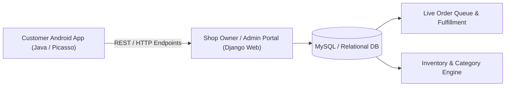

# Integrated Food & Grocery Delivery — Django Web Portal

[](https://djangoproject.com)
[](https://python.org)
[](https://mysql.com)
[](https://github.com/KishoreM-04/Integrated-Food-Grocery-Delivery-App)

> The centralized administrative and merchant backend for an integrated multi-vendor food and grocery delivery ecosystem. Engineered with Django, this portal manages item inventories, categories, order fulfillment lifecycles, and serves API data to the companion Android mobile application.

---

## 🏗️ Architecture & Workflows



---

## ✨ Features
- **Merchant & Admin Dashboard:** Real-time visibility into incoming grocery and food orders.
- **Product & Inventory Management:** Add, edit, price, and categorize grocery items and food dishes with image uploads.
- **Order Dispatch Workflow:** Track orders from placement to confirmation, preparation, and delivery completion.
- **Mobile Integration Layer:** Exposes structured endpoints consumed by the native Android client application.

---

## 🛠️ Stack & Dependencies
- **Backend Framework:** Django (Python 3.9+)
- **Database:** MySQL / SQLite
- **Frontend Admin UI:** Bootstrap 5, Custom CSS, JavaScript
- **Static & Media Asset Engine:** Django Staticfiles & Media Handlers

---

## ⚡ Quickstart
```bash
git clone https://github.com/KishoreM-04/Integrated-Food-Grocery-Delivery-Web.git
cd Integrated-Food-Grocery-Delivery-Web

python -m venv venv
.\venv\Scripts\Activate.ps1   # On Windows

pip install -r requirements.txt
python manage.py migrate
python manage.py createsuperuser
python manage.py runserver
```
Access the admin portal at `http://127.0.0.1:8000/`.
