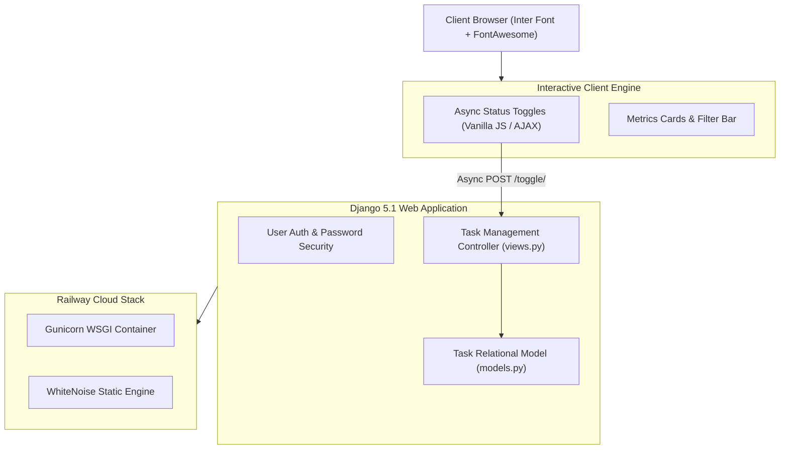

# TaskFlow — Cloud Full-Stack Task Management Platform

[](https://python.org)
[](https://djangoproject.com)
[](https://railway.app)
[](https://gunicorn.org)
[](https://whitenoise.readthedocs.io)

> A modern, production-configured task orchestration engine engineered with Django 5.x. Features a responsive UI, real-time metrics dashboard, asynchronous task status toggling via AJAX, and complete configuration for Railway cloud PaaS deployment.

---

## 🏗️ Architecture & Interaction Flow



---

## ✨ Features

- **🔐 Isolated User Authentication:** Secure account registration and session-based login with encrypted credentials.
- **⚡ Asynchronous Status Updates:** Toggle task statuses (`To Do`, `In Progress`, `Done`) instantly via AJAX without triggering full browser reloads.
- **🎨 Priority & Deadline Urgency:** Categorize tasks by urgency (`Low`, `Medium`, `High`) with automatic overdue visual indicators.
- **📊 Real-Time Metrics:** Live dashboard calculating completed, ongoing, and overdue tasks.
- **☁️ Cloud Pre-Configured:** Pre-wired for zero-friction Railway deployment via `Procfile`, `runtime.txt`, Gunicorn WSGI, and WhiteNoise static asset compression.

---

## 🛠️ Technology Stack

- **Backend:** Django 5.1.6, Python 3.11
- **Database:** SQLite (development) / PostgreSQL (production)
- **Frontend:** Semantic HTML5, CSS3, Vanilla ES6 JavaScript (AJAX), FontAwesome Icons, Inter Typography
- **Cloud Infrastructure:** Railway PaaS, Gunicorn 21.2.0, WhiteNoise 6.8.2

---

## ⚡ Local Development Setup

```bash
# 1. Clone repository
git clone https://github.com/KishoreM-04/TaskFlow.git
cd TaskFlow

# 2. Virtual environment setup
python -m venv venv
.\venv\Scripts\Activate.ps1    # On Windows
# source venv/bin/activate      # On Linux/macOS

# 3. Install packages
pip install -r requirements.txt

# 4. Migrate database
python manage.py migrate

# 5. Launch development server
python manage.py runserver
```
Navigate to `http://127.0.0.1:8000/` in your browser.
