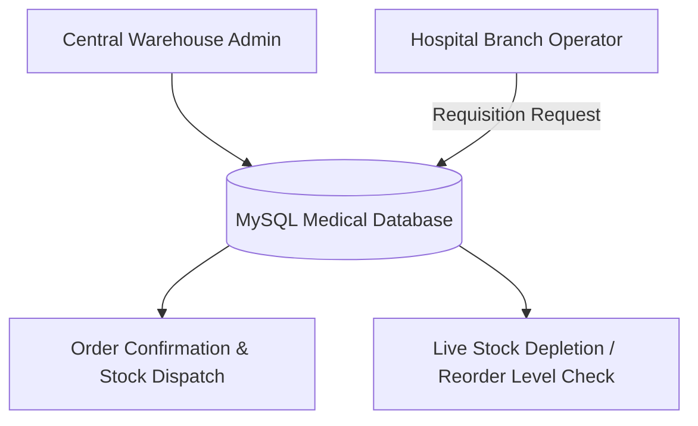

# Medical Equipment Warehouse Management System

[](https://php.net)
[](https://mysql.com)
[](https://getbootstrap.com)
[](https://github.com/KishoreM-04)

> A database-backed logistics and supply-chain management application engineered with PHP and MySQL to maintain, track, and dispatch medical equipment across multiple hospital branches and warehouse distribution hubs.

---

## 🏥 Operational Workflow



---

## ✨ Features

- **Multi-Branch Operations:** Manage discrete medical branch accounts, allowing branch administrators to review equipment availability and request supplies.
- **Equipment Inventory Catalog:** Track devices, serials, quantities, models, and maintenance classifications with photo attachments.
- **Cart & Requisition Engine:** Branch users can stage equipment orders in a dynamic cart and submit confirmed requisition orders (`add_cart.php`, `Order_Confirm.php`).
- **Administrative Control Suite:** Master oversight over branch registrations, category creation, stock replenishment, and delivery verifications.

---

## 🛠️ Stack & Dependencies

- **Server-Side Engine:** PHP 7.4+ / 8.x
- **Database:** MySQL / MariaDB (Relational schema with foreign keys)
- **Client Interface:** HTML5, CSS3, Bootstrap 4, JavaScript
- **Local Environment:** XAMPP / WAMP / Apache

---

## 🚀 Setup & Installation (XAMPP / Local Apache)

1. Clone or extract this repository into your local web server root (e.g. `C:\xampp\htdocs\medical_warehouse`).
2. Open **phpMyAdmin** (`http://localhost/phpmyadmin`).
3. Create a new database (e.g. `medical_warehouse_db`).
4. Import the provided SQL database dump file.
5. Verify your database connection credentials in `Branch/DB_Connection.php`:
   ```php
   $servername = "localhost";
   $username = "root";
   $password = "";
   $dbname = "medical_warehouse_db";
   ```
6. Start Apache and MySQL modules in your XAMPP Control Panel.
7. Open `http://localhost/medical_warehouse/` in your browser.
