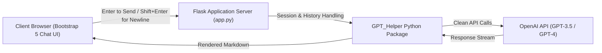

# GPT_Helper_App — Conversational AI Interface & Python Library

[](https://python.org)
[](https://flask.palletsprojects.com)
[](https://openai.com)
[](LICENSE)

> A lightweight, modular Python library and Flask web interface designed to streamline interacting with OpenAI's ChatGPT models. Offers clean API abstraction wrappers, text utilities, and a ChatGPT-style browser application supporting concurrent chat sessions, persistent sidebar history, and keyboard navigation.

---

## 🤖 Application Architecture



---

## ✨ Features

- **ChatGPT-Style Web UI:** Clean, responsive chat interface styled with Bootstrap and custom dark-accents.
- **Concurrent Chat Sessions:** Create, switch between, and manage multiple parallel conversational threads.
- **Sidebar Session History:** Automatic session naming and chronological sidebar history navigation.
- **Intuitive Keyboard Controls:** `Enter` to dispatch messages, `Shift + Enter` for multi-line inputs.
- **Reusable Python Library:** Provides clean utility functions for standalone Python scripts outside the web server.

---

## 🛠️ Project Structure

```
GPT_Helper_App/
├── app.py               # Flask web server & route controllers
├── requirements.txt     # Python dependencies (Flask, openai, python-dotenv)
├── .env.example         # Template for API keys
└── templates/
    └── index.html       # Single-page chat interface
```

---

## ⚡ Quickstart Setup

### 1. Clone & Prepare Virtual Environment
```bash
git clone https://github.com/KishoreM-04/GPT_Helper_App.git
cd GPT_Helper_App

# Windows
python -m venv venv
.\venv\Scripts\Activate.ps1

# Linux / macOS
python3 -m venv venv
source venv/bin/activate
```

### 2. Install Dependencies
```bash
pip install -r requirements.txt
```

### 3. Configure API Credentials
Create a `.env` file in the project root:
```env
OPENAI_API_KEY=your-openai-api-key-here
FLASK_SECRET_KEY=your-secure-flask-secret-key
```

### 4. Run the Application
```bash
python app.py
```
Open your browser and navigate to `http://127.0.0.1:5000/`.
